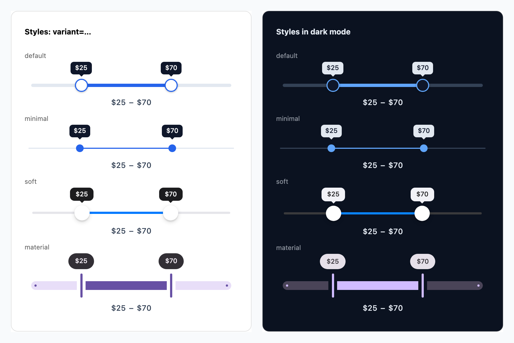

# react-multi-input-rangeslider

[](https://www.npmjs.com/package/react-multi-input-rangeslider)
[](https://github.com/Samishan11/react-simple-price-range-slider/actions/workflows/ci.yml)
[](https://www.npmjs.com/package/react-multi-input-rangeslider)
[](LICENSE)

A small, accessible, themeable **range slider** for React with one, two or more thumbs, built for price filters and any other numeric range. Zero runtime dependencies, TypeScript types included, works with React 16.8 – 19, server rendering and React Server Components (Next.js App Router).



- **One, two or many thumbs**: pass a number, an array or `{ min, max }`, and `onChange` reports the same shape
- Controlled **and** uncontrolled; horizontal or **vertical**; **inverted**; RTL
- `step` (or `"any"`), `minGap`, `disabled`, custom value formatting (`Intl.NumberFormat`, currencies, units…)
- Themeable with **CSS variables**; light / dark / auto themes
- Value tooltips, tick marks (auto or custom labels)
- Precise pointer handling: click the track to jump, thumbs can meet exactly, and overlapping thumbs separate in the direction you drag
- Drag the whole range; thumbs that **push** or **swap** when they meet; lock single thumbs; read-only mode
- Snap to marks; `Intl.NumberFormat` formatting (`format`, `locale`); a `ref` handle
- Accessible: a native range input per thumb (screen readers, mobile swipe gestures, forms), full WAI-ARIA keyboard support, 24px targets, forced-colors and reduced-motion support
- **Tailwind-ready**: utility classes on every part, an `unstyled` mode, and a cascade-layered stylesheet for Tailwind v4
- Custom thumb and tooltip content (`renderThumb`, `renderTooltip`), or your own markup with the `useRangeSlider` hook

## Install

```sh
npm install react-multi-input-rangeslider
```

## Usage

```tsx
import { useState } from "react";
import MultiRangeSlider from "react-multi-input-rangeslider";
import "react-multi-input-rangeslider/style.css";

export default function PriceFilter() {
  const [range, setRange] = useState({ min: 200, max: 800 });

  return (
    <MultiRangeSlider
      min={0}
      max={1000}
      step={10}
      value={range}
      onChange={setRange}
      formatValue={(n) => `$${n}`}
      tooltip
      ariaLabel="Price range"
    />
  );
}
```

Uncontrolled? Drop `value` and use `defaultValue` (or nothing, to start at the full range):

```tsx
<MultiRangeSlider min={0} max={100} defaultValue={{ min: 20, max: 80 }} onChangeEnd={(v) => fetchResults(v)} />
```

### One, two or more thumbs

`RangeSlider` takes the value in any shape and reports it back in the same shape:

```tsx
import { RangeSlider } from "react-multi-input-rangeslider";

<RangeSlider defaultValue={40} onChange={(n) => setVolume(n)} />          // one thumb: a number
<RangeSlider defaultValue={[200, 800]} onChange={([lo, hi]) => …} />      // two thumbs: an array
<RangeSlider defaultValue={[10, 40, 70]} />                               // three or more
<RangeSlider defaultValue={{ min: 2, max: 8 }} orientation="vertical" />  // { min, max } works too
```

`MultiRangeSlider` (the default export) is the same component, except that with no `value` / `defaultValue` it reports `{ min, max }` like 2.x did; `RangeSlider` reports an array. Both callbacks also receive a second argument, `{ thumb, source }`: which thumb moved, and whether a pointer, a key or assistive technology moved it.

> The old `react-multi-input-rangeslider/style/style.css` import path still works.

## Props

| Prop | Type | Default | Description |
| --- | --- | --- | --- |
| `min` | `number` | `0` | Lowest selectable value. |
| `max` | `number` | `100` | Highest selectable value. Always reachable, even when it isn't a multiple of `step`. |
| `value` | `number \| number[] \| { min, max }` | — | Controlled value. Pair with `onChange`. |
| `defaultValue` | same as `value` | full range | Initial value when uncontrolled. |
| `onChange` | `(value, { thumb, source }) => void` | — | Called on every change while dragging, on each key press, and when assistive technology moves a thumb. |
| `onChangeEnd` | `(value, { thumb, source }) => void` | — | Called once when a drag, key press or assistive-technology adjustment is committed. Handy for fetching. |
| `step` | `number \| "any"` | `1` | Slider granularity. `"any"` allows every value. |
| `largeStep` | `number` | ~10% of the range | Step for PageUp / PageDown and Shift + arrows. |
| `onDragStart` / `onDragEnd` | `({ thumb }) => void` | — | A pointer drag of a thumb starts / ends (`thumb` is `-1` for the whole range). |
| `minGap` | `number` | `0` | Minimum distance between neighbouring thumbs. `0` lets them meet. |
| `maxGap` | `number` | — | Maximum distance between neighbouring thumbs: with `"block"` a thumb stops there, with `"push"` it pulls its neighbour along. |
| `collision` | `"block" \| "push" \| "swap"` | `"block"` | When a thumb meets its neighbour: it stops, pushes the neighbour along, or passes it (`minGap` doesn't apply to `"swap"`). |
| `draggableRange` | `boolean` | `false` | Press the filled range and drag to move all thumbs together. |
| `disabledThumbs` | `boolean[]` | — | Lock thumbs by index, e.g. `[true, false]`. Pressing a locked thumb does nothing. |
| `readOnly` | `boolean` | `false` | Show the value but ignore input; thumbs stay focusable, so screen readers can read them. |
| `snapToMarks` | `boolean` | `false` | Thumbs stop only at mark values (needs `marks`). |
| `format` | `Intl.NumberFormatOptions` | — | Formats values, e.g. `{ style: "currency", currency: "EUR" }`. `formatValue` takes precedence. |
| `locale` | `string \| string[]` | the browser's | Locale(s) for `format`, e.g. `"de-DE"`. |
| `disabled` | `boolean` | `false` | Disable every thumb. |
| `orientation` | `"horizontal" \| "vertical"` | `"horizontal"` | Vertical sliders have the minimum at the bottom; their length is `--rs-height`. |
| `inverted` | `boolean` | `false` | Puts the maximum at the start: left (right in RTL), or the top when vertical. |
| `formatValue` | `(n: number) => string` | `` `${currencyText}${n}` `` | Formats the displayed values, tooltips, labels and `aria-valuetext`. |
| `showValues` | `boolean` | `true` | Show the values row under the slider. |
| `tooltip` | `boolean \| "hover" \| "always"` | `false` | Value bubble over each thumb. `true` = `"hover"` (also on keyboard focus and drag). `"always"` reserves space above the slider, and merges the tooltips of close thumbs into one (`$480 – $520`). Tooltips never overflow the slider's ends. |
| `marks` | `boolean \| number \| { value, label? }[]` | — | Tick marks. `true` = 4 intervals; a number = that many; or an array of custom marks. |
| `theme` | `"light" \| "dark" \| "auto"` | light | `"auto"` follows the OS colour scheme. |
| `dir` | `"ltr" \| "rtl"` | — | Text direction. Arrow keys follow it. |
| `name` | `string` | — | Form field name. One thumb submits `name`, two submit `${name}-min` / `${name}-max`, more submit `name` once per thumb. |
| `ariaLabel` | `string` | — | Accessible name of the slider (a labelled `role="group"` when there are several thumbs). |
| `minAriaLabel` / `maxAriaLabel` | `string` | `"Minimum value"` / `"Maximum value"` | Accessible names of the two thumbs of a range. |
| `getAriaLabel` | `(index: number) => string` | — | Accessible name of each thumb, by index. Takes precedence over the other labels. |
| `className` / `style` | | | Applied to the root element. |
| `classNames` / `styles` | `Partial<Record<Slot, …>>` | — | Per-part overrides. Slots: `root control track range thumb tooltip tooltipLabel marks mark markLabel values value separator`. |
| `unstyled` | `boolean` | `false` | Leave out the built-in `rs-*` classes and style every part yourself (see [Tailwind CSS](#tailwind-css)). Layout still works: it's inline. |
| `renderThumb` | `(thumb) => ReactNode` | — | Content inside each thumb. |
| `renderTooltip` | `(thumb) => ReactNode` | — | Content of each tooltip label instead of the formatted value. |
| `width` | `string` | `250px` | Slider width (sets `--rs-width`). |
| `rangeColor` / `trackColor` | `string` | — | Shortcuts for `--rs-range-color` / `--rs-track-color`. |
| `currencyText` | `string` | `"$"` | Prefix used when neither `formatValue` nor `format` is set. |
| `valueStyle` | `CSSProperties` | — | Inline style for the values row. |

## Theming

Everything visual is a CSS variable. Override them on the slider, a wrapper, or globally:

```css
.my-slider {
  --rs-range-color: #db2777;
  --rs-thumb-size: 28px;
  --rs-track-height: 10px;
}
```

| Variable | Default (light) |
| --- | --- |
| `--rs-width` | `250px` |
| `--rs-track-color` | `#e2e8f0` |
| `--rs-range-color` | `#2563eb` |
| `--rs-track-height` | `6px` |
| `--rs-thumb-size` | `24px` |
| `--rs-thumb-color` | `#fff` |
| `--rs-thumb-border-color` | `var(--rs-range-color)` |
| `--rs-thumb-border-width` | `2px` |
| `--rs-focus-ring` | translucent range-colour ring |
| `--rs-value-color` | `#334155` |
| `--rs-font-size` | `0.875rem` |
| `--rs-tooltip-bg` / `--rs-tooltip-color` | `#0f172a` / `#fff` |
| `--rs-mark-color` | `#64748b` |
| `--rs-height` | `200px` (length of a vertical slider) |
| `--rs-thumb-shadow` | `0 1px 3px rgb(0 0 0 / 0.25)` |
| `--rs-tooltip-font-size` / `--rs-tooltip-offset` | `0.75rem` / `8px` |

Dark mode: `theme="dark"`, or `theme="auto"` to follow `prefers-color-scheme`.

State attributes you can style (or target with Tailwind's `data-*` variants):

| Part | Attributes |
| --- | --- |
| thumb | `data-index`, `data-active` (last used, drawn on top), `data-hover`, `data-dragging`, `data-focus-visible`, `data-disabled` |
| range (fill) | `data-draggable`, `data-hover`, `data-dragging` |
| tooltip | `data-visible` (shown: always, or on hover / drag / keyboard focus), `data-merged` (folded into a shared label) |
| mark | `data-active` (inside the selected range) |
| control | `data-hover`, `data-dragging` |
| root | `data-orientation`, `data-disabled`, `data-readonly`, `data-tooltip` |

Thumbs can be any size, set by `--rs-thumb-size` or by a class: the slider measures the rendered thumb, so positions and dragging always line up with it.

## Tailwind CSS

Pick how much of the default look you keep:

**1. Default look, override parts with utilities (Tailwind v4).** Import the layered stylesheet after Tailwind. Its rules join Tailwind's `components` layer, so your utility classes win without `!`:

```css
/* app.css */
@import "tailwindcss";
@import "react-multi-input-rangeslider/style.layer.css";
```

```tsx
<RangeSlider defaultValue={[20, 80]} classNames={{ range: "bg-pink-500", thumb: "size-8 border-pink-500" }} />
```

**2. Theme with the CSS variables**, e.g. `className="[--rs-range-color:var(--color-pink-500)] [--rs-thumb-size:2rem]"`.

**3. Style everything yourself with `unstyled`.** No built-in classes and no stylesheet needed; the layout is inline. Use the data attributes above for states:

```tsx
<RangeSlider
  unstyled
  defaultValue={[20, 80]}
  tooltip
  classNames={{
    control: "h-5",
    track: "h-1.5 rounded-full bg-zinc-200",
    range: "rounded-full bg-zinc-900",
    thumb: "size-5 rounded-full border-2 border-zinc-900 bg-white shadow data-[dragging]:scale-110 data-[focus-visible]:ring-4",
    tooltip: "opacity-0 transition-opacity data-[visible]:opacity-100",
    tooltipLabel: "rounded bg-zinc-900 px-2 py-0.5 text-xs text-white",
    values: "mt-3 flex justify-between text-sm",
    separator: "hidden",
  }}
/>
```

Tailwind v3 has no native cascade layers: use `unstyled`, or the `!` modifier (`!bg-pink-500`) next to the regular `style.css`.

### Custom thumbs and tooltips

```tsx
<RangeSlider
  defaultValue={[200, 800]}
  renderThumb={({ dragging }) => <GripIcon className={dragging ? "opacity-100" : "opacity-60"} />}
  renderTooltip={({ formatted }) => <strong>{formatted}</strong>}
/>
```

Both renderers get `{ index, value, formatted, active, hover, dragging, focusVisible, disabled }`.

## Ref

A `ref` gives you a handle that speaks the slider's value shape:

```tsx
const slider = useRef<RangeSliderHandle<number[]>>(null);

<RangeSlider ref={slider} defaultValue={[20, 80]} />;

slider.current?.getValue(); // [20, 80]
slider.current?.setValue([0, 100]); // uncontrolled sliders only
slider.current?.focus(1); // keyboard focus on the upper thumb
slider.current?.element; // the root <div>
```

## Keyboard

Each thumb follows the WAI-ARIA slider pattern:

| Keys | Action |
| --- | --- |
| Arrow Right / Up | One step up (Arrow Left goes up in RTL) |
| Arrow Left / Down | One step down |
| Shift + arrow, Page Up / Page Down | A large step (`largeStep`, ~10% by default) |
| Home / End | To the lowest / highest value the thumb can reach |

## Headless: `useRangeSlider`

For fully custom markup, the hook gives you the same behaviour as `RangeSlider` (pointer, keyboard, assistive technology, positions as inline styles) with values as arrays. The hook is new in 3.0 and its API may still change before the stable release.

```tsx
import { useRangeSlider } from "react-multi-input-rangeslider";

function MySlider() {
  const s = useRangeSlider({ min: 0, max: 100, defaultValues: [20, 80] });
  return (
    <div {...s.getControlProps()} className="my-control">
      <div {...s.getTrackProps()} className="my-track">
        <div {...s.getRangeProps()} className="my-fill" />
      </div>
      {s.values.map((v, i) => (
        <div key={i} {...s.getThumbProps(i)} className="my-thumb">
          <input {...s.getInputProps(i)} aria-label={i ? "Maximum" : "Minimum"} />
        </div>
      ))}
    </div>
  );
}
```

## Migrating from 2.x to 3.0

**Every 2.x prop still works**, and `MultiRangeSlider` still reports `{ min, max }`. What changed is the markup, which matters only if you wrote CSS against it:

- **Thumbs are real elements.** `.rs-thumb` is now the visible thumb (a `div`) instead of a native `<input type="range">` drawn through `::-webkit-slider-thumb` / `::-moz-range-thumb`. Each thumb contains a visually hidden `.rs-input`, which is still the focusable `role="slider"`, carries the form value and supports screen readers. Move custom thumb CSS from the pseudo-elements to `.rs-thumb`, and `:focus-visible` styles to `.rs-thumb[data-focus-visible]`.
- **`.rs-rail` is gone**: `.rs-range` (the fill) now sits inside `.rs-track`. Positions are inline styles, and the root no longer sets `--rs-left` / `--rs-right`.
- **Tooltips** are `.rs-tooltip` (a zero-width anchor at the thumb centre) around `.rs-tooltip-label` (the bubble). Move bubble styles to `.rs-tooltip-label`.
- **`min` / `max` are optional** (0 / 100), and the callbacks get a second argument, `{ thumb, source }`.
- **`onChangeEnd` also fires for assistive technology** (e.g. a VoiceOver swipe), which previously never ended an adjustment.

## Migrating from 1.x

2.0 is mostly additive — **the 1.x props still work** (`min`, `max`, `onChange`, `rangeColor`, `trackColor`, `currencyText`, `valueStyle`, `width`). What changed:

- **Markup & class names.** The old `.thumb`, `.slider`, `.track-slider`, `.range-slider` classes are gone (replaced by `.rs-*`). If you overrode them in your own CSS, switch to the `--rs-*` variables or the `classNames` / `styles` props.
- **Tailwind classes removed** from the value labels (`text-xs font-medium` were never shipped with the package). Use `styles.value` / `classNames.value` instead.
- **`onChange` timing.** It now fires from the input event itself (not from an effect), only when the value actually changes, and never on mount.
- **Default thumb is 24px** (was 18px) and the default look is updated.
- **Peer dependencies** are now `react >=16.8 <20` and `react-dom >=16.8 <20`; the package ships ESM + CJS with types.
- **Bug fixes:** `disabled` now works (it was documented but missing); `min` / `max` prop changes are respected; the fill is exact (no whole-percent rounding); thumbs no longer get stuck when both sit at the max end.
- **Controlled mode is new:** pass `value` to drive the slider from state (e.g. a "reset filters" button).

## Development

```sh
npm install
npm run dev            # playground at http://localhost:5173
npm test               # unit tests (vitest + jsdom)
npm run test:e2e       # real-browser tests: Chromium, Firefox, WebKit (first run: npx playwright install)
npm run typecheck
npm run build          # dist/ (ESM, CJS, d.ts, style.css)
npm run check:package  # after build: publint, attw, "use client", size budget
npm run test:consumer  # after build: installs the packed tarball into a Next.js app and builds it
npm run docs           # static playground into ./site
```

## License

MIT
